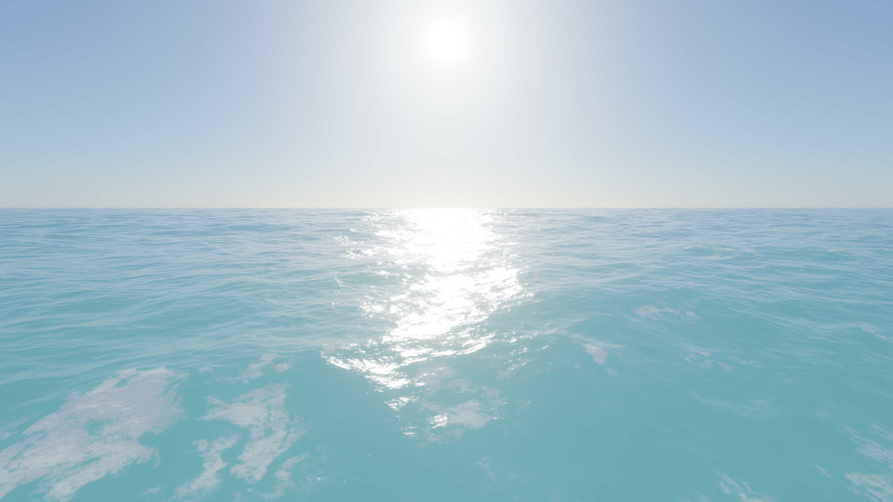
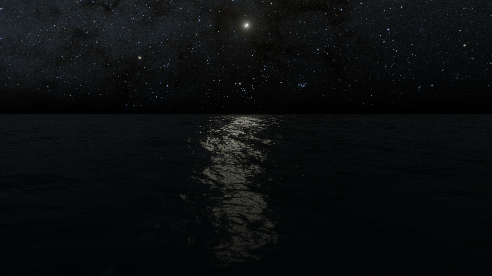
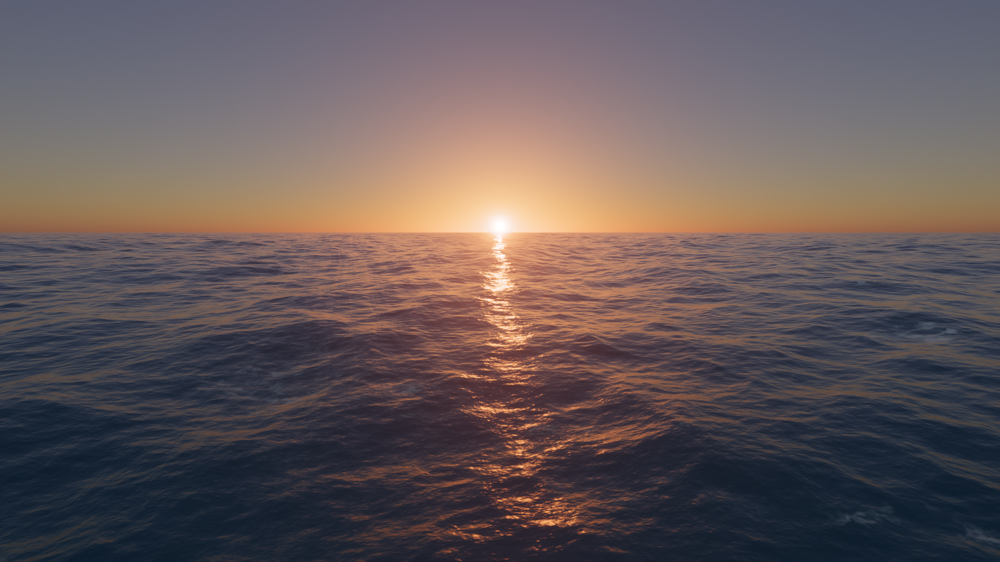
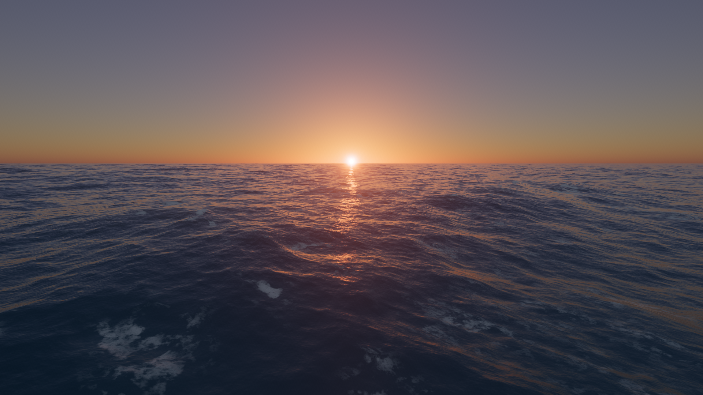
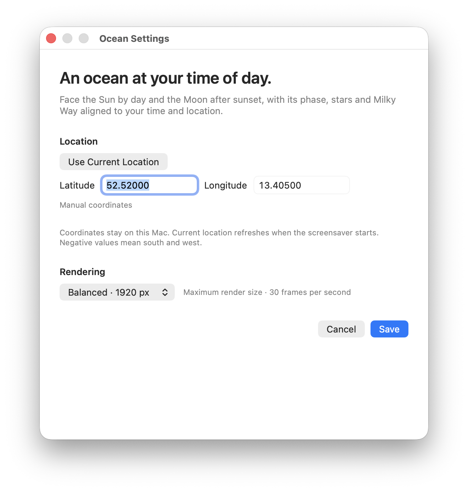

# Ocean for macOS

A Mac screensaver port of [Noniv/web-ocean](https://github.com/Noniv/web-ocean). It preserves the original ocean simulation, foam, atmosphere, reflections, and post-processing, translated to native Metal inside a `ScreenSaverView`. The sky is cloudless. No browser or WebKit process runs in either target.

The camera faces the **Sun during the day and the Moon after sunset**. The current date, time, latitude and longitude determine their actual elevation. The Moon's visible phase, illuminated limb, stars and Milky Way follow the same astronomical frame. There are no controls, key bindings, instructions or performance overlays in the screensaver.

## Views

| Day | Night |
| --- | --- |
|  |  |

| Sunrise | Sunset |
| --- | --- |
|  |  |

These screenshots are captured directly from the native Metal renderer using fixed dates and coordinates, without changing saved settings. See [capture details](docs/screenshots/README.md) to reproduce the views.

**Settings** — example coordinates for Berlin (52.52° N, 13.405° E).



## Download and install

**[Download Ocean.saver.zip](https://github.com/volzinnovation/mac-ocean-screensaver/releases/latest/download/Ocean.saver.zip)** · [All releases](https://github.com/volzinnovation/mac-ocean-screensaver/releases)

Requires **macOS 26 or later** and a Metal-capable GPU. The release contains both Apple Silicon and Intel binaries. Rendering has been verified on Apple Silicon; Intel runtime testing still requires an Intel Mac.

1. Download and unzip `Ocean.saver.zip`.
2. Open `Ocean.saver` and follow the macOS installation prompt. Select **Ocean** in System Settings' screen saver settings.
3. Open Ocean's **Options** to enter latitude, longitude and rendering quality, then **Save**. North/east coordinates are positive; south/west are negative.
4. To use your Mac's location, choose **Use Current Location…**. In the companion settings window, click **Use Current Location**, grant the macOS location permission, then **Save**.

The companion settings app is embedded in `Ocean.saver`; no separate download is needed. Until a location is configured, Ocean uses a representative city for the system time zone, clearly labelled as an approximation in settings.

The release is **ad-hoc signed and not notarized**. macOS may block a downloaded copy because its developer cannot be verified. If you trust this download, follow Apple's [instructions for opening unnotarized software](https://support.apple.com/102445): after attempting to open it, check **System Settings → Privacy & Security** for **Open Anyway**. Availability depends on macOS and your organization's security policy. Developer ID signing and notarization are not included in this release.

Balanced quality caps the longest rendered edge at 1920 pixels and submits 30 frames per second. Efficient and Detailed use 1280 and 2560 pixels respectively. Preview tiles use at most 1280 pixels. Animation and GPU resources stop when the screensaver stops.

## Build from source

Building requires macOS 26+, Xcode command-line tools with the macOS 26 SDK, the Xcode Metal Toolchain, and Python 3. No third-party packages or server are needed for a normal build.

```sh
git clone https://github.com/volzinnovation/mac-ocean-screensaver.git
cd mac-ocean-screensaver
make build
```

This creates:

- `build/Ocean.saver` — the self-contained screensaver, including its settings app.
- `build/Ocean.saver.zip` — the release archive.
- `build/Ocean Settings.app` — a standalone windowed preview and settings app.

Open `build/Ocean.saver` to install a local build. The standalone settings app opens location settings on its first launch. Building does not install or select the screensaver.

Both architectures are built by default. To build just one:

```sh
ARCHS=arm64 ./scripts/build.sh
# or ARCHS=x86_64 ./scripts/build.sh
```

## Time and location

Solar position uses NOAA/Meeus equations, evaluated from the absolute UTC instant. It updates every ten seconds and accounts for date, seasons, longitude and latitude without depending on daylight-saving offsets. At standard sunset (Sun's geometric centre below −0.833°), the camera turns toward the Moon's actual azimuth. A Moon below the horizon stays below it; Ocean never raises the Moon to make it visible.

The lunar model includes all 120 Meeus longitude/range/latitude periodic terms, WGS84 observer parallax, the physical angular radius and Sun–Moon–observer illumination geometry. The shader lights a sphere from the actual Moon-to-Sun direction, giving the correct phase and rotated bright limb from either hemisphere. Lunar reflections follow its elevation and illumination. Positions are checked against NASA/JPL DE441 references; the supported date range is 1800–2200.

The stars and Milky Way come from NASA SVS's measured **Deep Star Maps 2020** atlas, with Hipparcos, Tycho and Gaia sources. Local sidereal time, precession and nutation rotate the J2000 atlas into the user's local horizon. This shows the sky actually lying in the Moon's direction. Stellar visibility fades with twilight, horizon extinction and moonlight; it assumes clear, dark skies and does not model local light pollution. Automatic night exposure keeps the sea, Moon and sky visible. There are no clouds in any mode.

Location permission is requested only after clicking **Use Current Location** in the companion app. The locked-screen host never requests permission. If permission was previously granted and current location is selected, starting the screensaver launches a hidden, short-lived helper to refresh the location. If Location Services is unavailable, the last saved coordinates remain in use. Manual coordinates remain fixed.

Coordinates stay on this Mac. Native Metal shaders and the star atlas are bundled locally; the renderer makes no network requests. Core Location may use macOS Location Services to obtain a fix.

macOS runs legacy screensavers in a separate sandbox. Native Options save directly to the host's own `Library/Application Support/OceanScreenSaver/settings.json`. The companion saves only to `~/Library/Application Support/OceanScreenSaver/settings.json`. The saver has a system-granted read-only filesystem entitlement and reads the newest valid document from these two locations; local edits win equal timestamps. The companion never accesses Apple's protected container, avoiding extra app-data permission prompts. Writes are atomic with user-only permissions.

Version 1.2.0 includes the cloudless lunar sky and native Metal renderer. The native renderer replaced the original WebKit wrapper in version 1.1. macOS 26.4 introduced a [reported WKWebView regression inside legacy screensavers](https://developer.apple.com/forums/thread/820860); an ordinary preview app did not reproduce that failure. Native rendering avoids that path entirely. The native Options sheet also works independently of companion-app launching.

## Validation

```sh
make test
./scripts/smoke-test.sh
```

The deterministic tests cover the NREL reference solar position, JPL lunar positions, NASA phase dates, local/J2000 transforms, seasons, polar locations, date-line and timezone equivalence, preference validation and newest-document selection. CPU parity fixtures compare uniform and CDLOD instance bytes against the original JavaScript. Scene tests check Moon/Sun camera selection, preservation of the actual Sun direction and atlas orientation. Generated-shader hashes verify the native Metal source matches the pinned WGSL input. Native Options validation and save/cancel behavior have a separate isolated GUI regression test.

The GUI smoke test needs a logged-in Mac with WindowServer access. It loads the compiled `.saver` by its principal class, rejects WebKit linkage and cloud rendering, checks 36 seconds of continuous native Sun/Moon-facing rendering and tiny preview resizing, verifies stop/restart behavior, and writes `build/screensaver-preview.png` from the GPU texture. It does not install the saver, change your settings or request location permission. The actual macOS full-screen host has also been visually verified after the native Metal replacement.

A reproducible sunset preview can be captured without changing saved settings:

```sh
"build/Ocean Settings.app/Contents/MacOS/OceanSettings" \
  --snapshot "$PWD/build/sunset.png" \
  --date 2026-10-17T16:00:00Z --latitude 52.52 --longitude 13.405
```

## Source and licensing

`Sources/ScreenSaver/` contains the native screensaver entry point. `Sources/Settings/` contains the companion host. `Sources/Shared/` contains solar calculations, location/settings persistence, the native Metal renderer, and original CPU state. `Resources/Web/js/` preserves the upstream renderer as editable reference source. `Resources/Metal/` contains generated Metal shaders, compiled by `scripts/compile-metal.sh`. To regenerate after a WGSL change, use `scripts/generate-metal.py` with a Node 20+ runtime and the pinned Naga WASM translator; its `--download-compiler` option fetches and integrity-checks the development tool into `build/tools/`. Normal builds need neither Node nor Naga.

The original renderer is MIT licensed, copyright © 2026 Maksymilian Dendura. Its license ships with both bundles. See [THIRD_PARTY_NOTICES.md](THIRD_PARTY_NOTICES.md) for the pinned upstream revision and calculation references.
